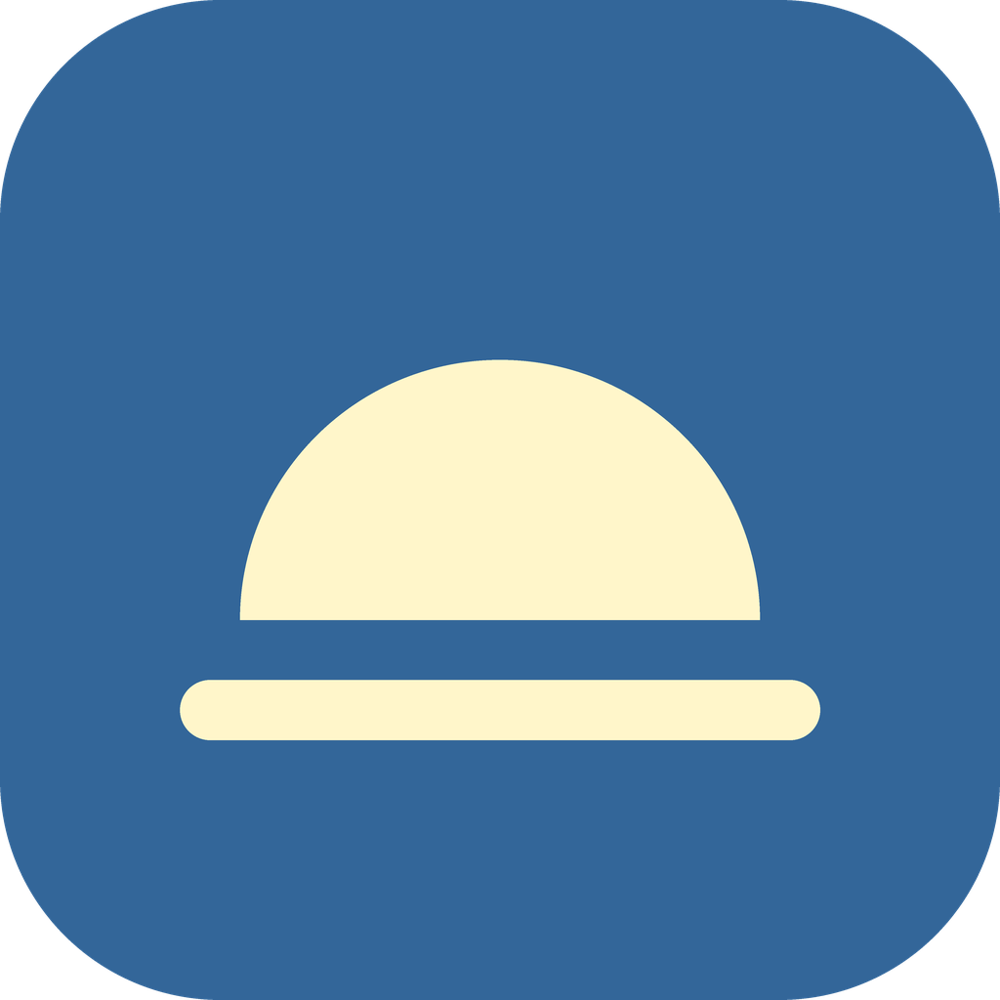
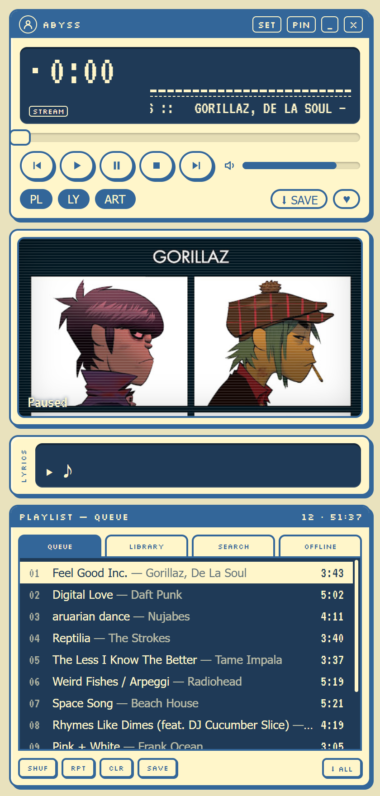
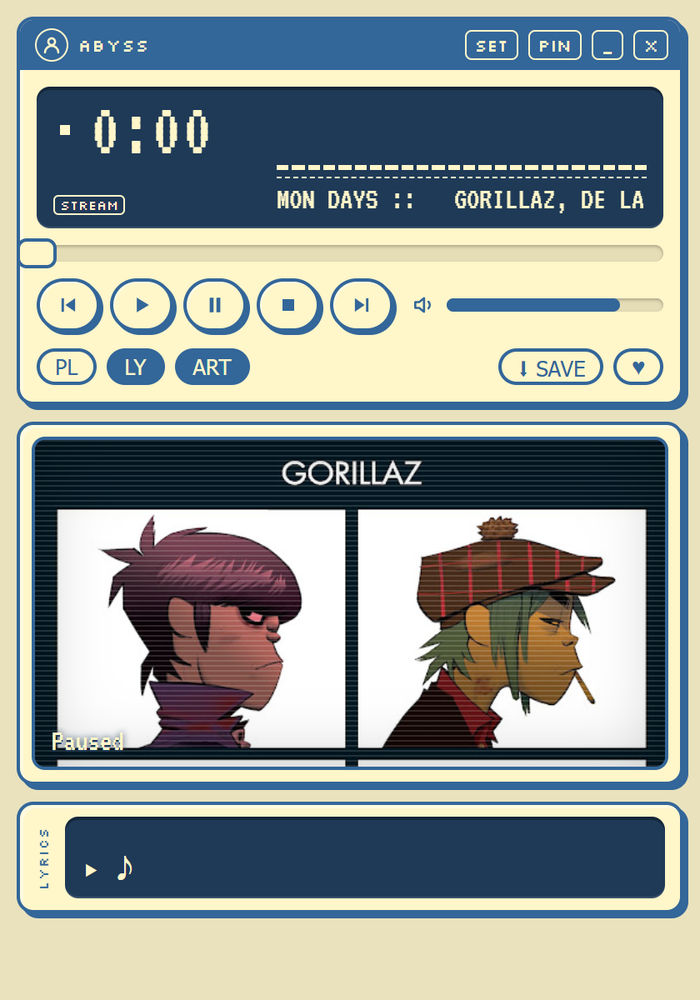
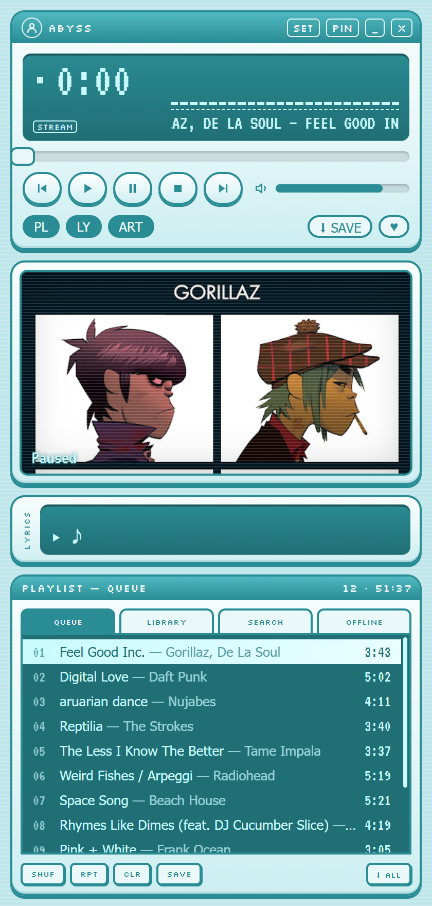
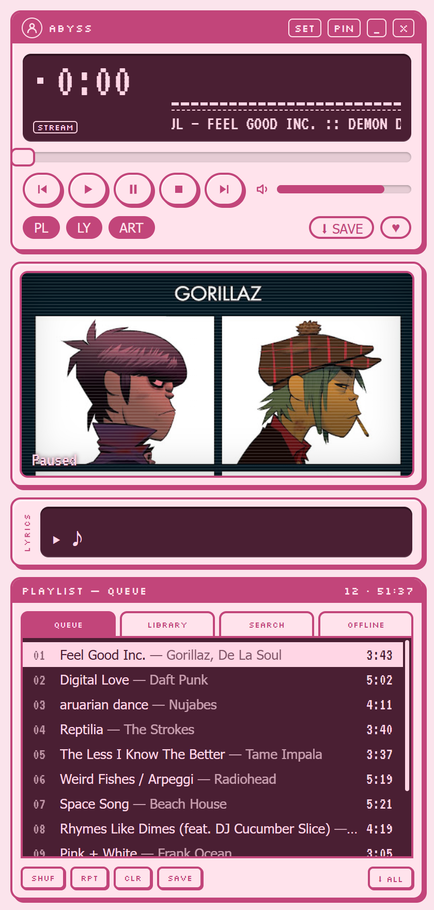
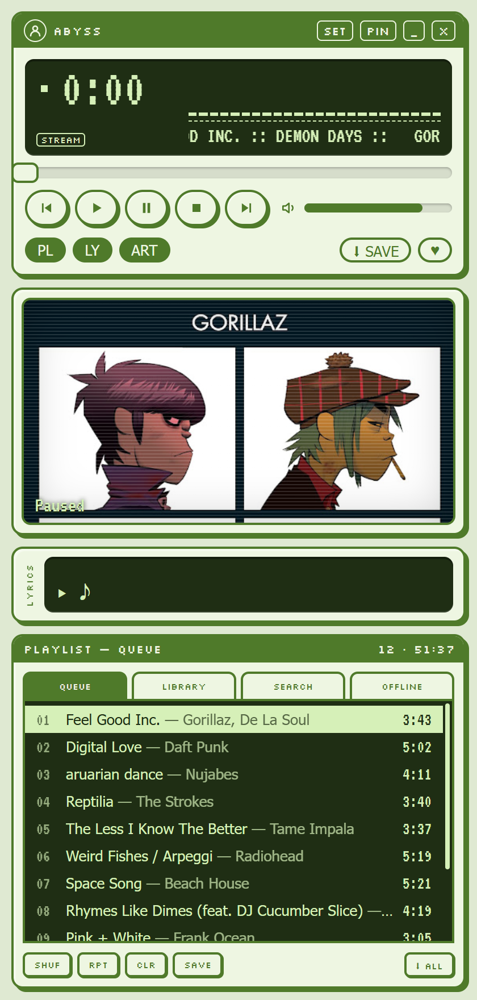
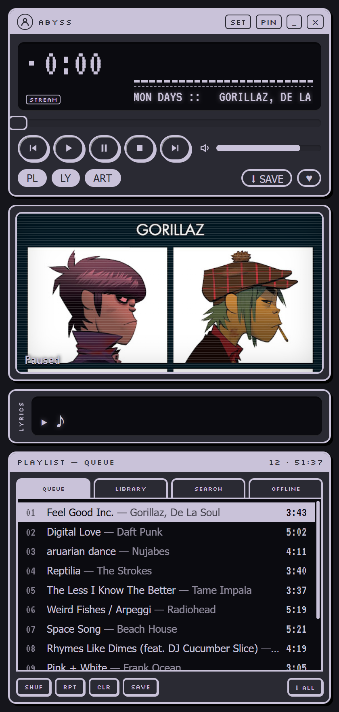
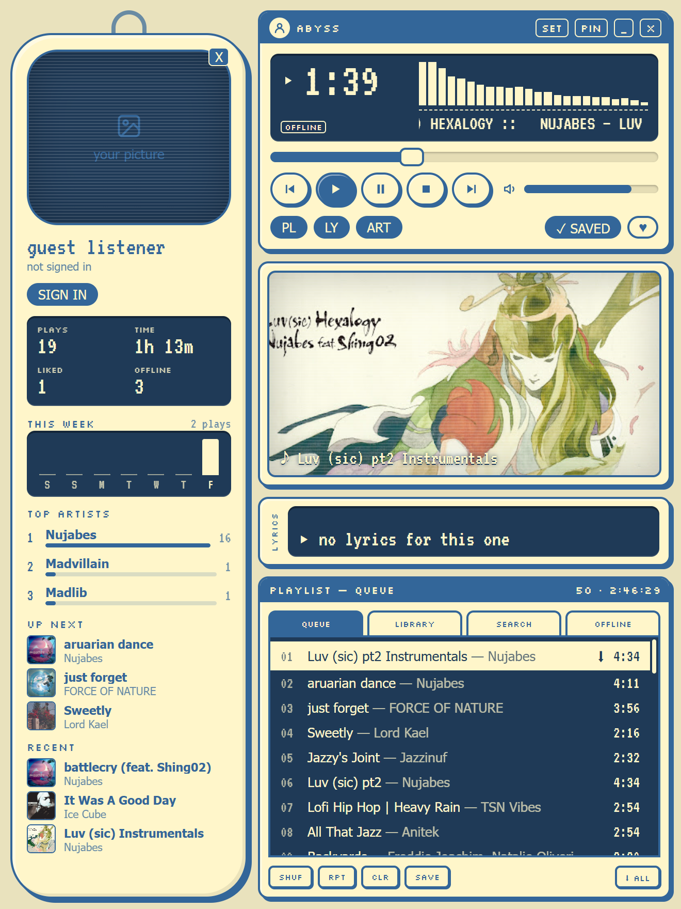
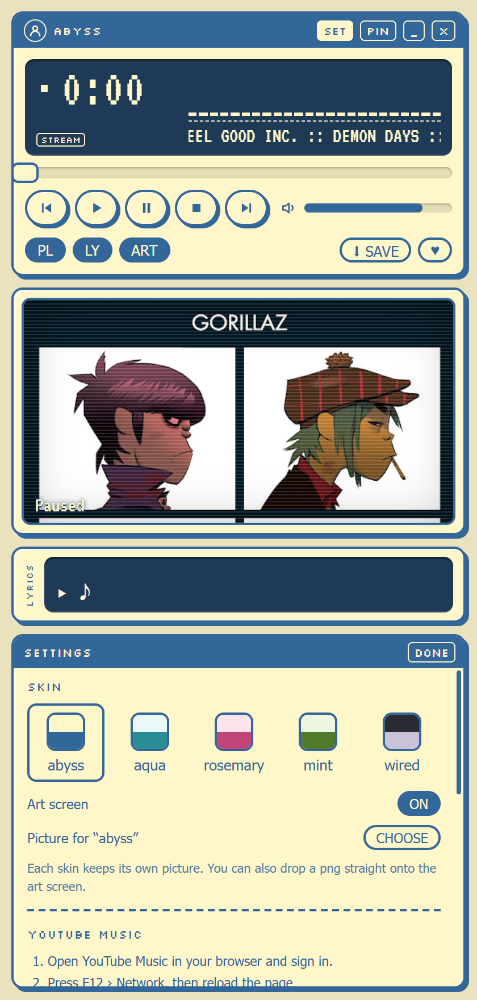

<p align="center">
  
</p>

<h1 align="center">abyss</h1>

<p align="center">
  a tiny old-school music player for the youtube music era.<br>
  winamp-shaped. infinite songs inside.
</p>

<p align="center">
  
  &nbsp;&nbsp;
  
</p>

---

## why this exists

i grew up with players like winamp and aimp. little stacked windows, a green-ish lcd, a
scrolling song title, a playlist you could snap underneath. they looked like *objects*.

music apps today have every song ever made, but they all look like the same spreadsheet.
abyss is me trying to get both: the whole youtube music catalogue, lyrics, offline downloads
and discord status, living inside a player that looks like it came off a 2004 desktop.
and you can skin it, because that was the best part.

it's small on purpose. it sits in the corner of your screen and plays music. that's the app.

## what it does

- **search and play anything on youtube music**: songs and music videos, with an endless radio that keeps going after your queue ends
- **artist pages**: click any artist name for their top songs, every song they have, albums, singles, videos and who fans also like
- **crossfade**: songs blend into each other like a dj mix (off, 3, 5, 8 or 12 seconds, in `SET`)
- **offline downloads**: hit `⬇ SAVE` on a song, or `⬇ ALL` on any list, and it plays without internet
- **synced lyrics** in a little lcd ticker under the player (from [LrcLib](https://lrclib.net), with youtube music as a fallback)
- **art screen**: the album cover behind scanlines, or your own picture in the back with the cover framed in front
- **skins**: five built in, and each one keeps its own background picture
- **profile panel**: click your avatar and a capsule slides out with your picture, plays, listening time, this week's listening, top artists and what's up next
- **playlists + library**: make and name your own playlists (right-click a song › add to playlist), your likes, and (signed in) your youtube music playlists
- **discord status**: shows what you're listening to on your profile while discord is open
- **folds up**: toggle `PL` (playlist), `LY` (lyrics) and `ART` (art screen). the window shrinks to fit
- **pin** it on top of other windows, media keys work, `space` plays/pauses, `ctrl + ←/→` skips

## skins

| abyss | aqua | rosemary | mint | wired |
| :---: | :---: | :---: | :---: | :---: |
|  |  |  |  |  |
| lemon chiffon + baltic blue, the original | glassy teal, old media player energy. swaps the taskbar icon too | cutecore pink | soft mint | dark and quiet, for 3am |

switch skins in `SET`. hover the art screen and press `PIC` (or just drop a png on it) to put
your own picture behind the cover: a character, an anime still, a photo, whatever. it's
saved per skin, so your pink skin can have a different picture than your teal one.

## profile + settings

<p align="center">
  
  &nbsp;&nbsp;
  
</p>

## install (windows)

1. grab `abyss-setup-x.x.x.exe` from [releases](https://github.com/Capri-cmd/ABYSS-PLAYER/releases)
2. run it. windows will probably say *"windows protected your pc"* because the app isn't code-signed yet. click **more info → run anyway**
3. that's it. python and everything else it needs ships inside the installer

## signing in (recommended)

you can search, play and download without an account, but youtube is a lot stricter with
logged-out players. signed in, things play much more reliably, your likes sync, and your
youtube music playlists show up in `LIBRARY › YOUTUBE`.

google doesn't let apps show its sign-in page inside them, so you sign in with your own browser:

1. open [music.youtube.com](https://music.youtube.com) in your browser and sign in
2. press `F12` → **network** tab, then reload the page
3. click any request to `music.youtube.com` and copy the whole **cookie** value under request headers
4. in abyss: `SET` → youtube music → paste it → **sign in**

the cookie is stored encrypted on your pc (using your os keychain) and never goes anywhere
except youtube. it keeps working until you sign out of youtube in that browser.

## build it yourself

you'll need [node.js](https://nodejs.org) 20+ and [python](https://www.python.org) 3.12 (python is only needed to build, not to run).

```bash
git clone https://github.com/Capri-cmd/ABYSS-PLAYER.git
cd ABYSS-PLAYER
npm install
npm run vendor     # downloads a private python with the latest yt-dlp into vendor/
npm run dev        # run it
npm run dist       # build the windows installer into release/
```

### make your own skin

skins live in `SKINS` at the top of [`src/Mini.jsx`](src/Mini.jsx): five colors and a name.

```js
mything: { name: 'mything', desk: '#…', body: '#…', ink: '#…', lcd: '#…', lcdInk: '#…' },
```

want it to change the taskbar icon too? drop an `icon.ico` / `icon.png` in
`assets/skins/mything/` and add it to `SKIN_ICONS` in [`electron/main.js`](electron/main.js).
extra styling (gradients, glow) goes in [`src/mini.css`](src/mini.css) under `.skin-mything`.

## when songs stop playing

youtube changes things on their side every so often and players like this break for a bit.
abyss uses [yt-dlp](https://github.com/yt-dlp/yt-dlp) for playback and downloads, and the
yt-dlp folks are usually fast to catch up. if songs suddenly won't play:

- sign in (see above). logged-in playback gets blocked much less
- update yt-dlp: `npm run vendor`, then `npm run dist` for a new installer
- songs you already downloaded keep working no matter what

## how it works (short version)

- [electron](https://www.electronjs.org) + [react](https://react.dev), built with [vite](https://vite.dev)
- [youtubei.js](https://github.com/LuanRT/YouTube.js) talks to youtube music (search, playlists, radio, your library)
- [yt-dlp](https://github.com/yt-dlp/yt-dlp) runs as a warm background worker to get audio streams and do downloads. abyss lends it its own electron binary as the javascript runtime, so nobody has to install node
- [LrcLib](https://lrclib.net) for synced lyrics, [@xhayper/discord-rpc](https://github.com/xhayper/discord-rpc) for discord
- fonts: [VT323](https://fonts.google.com/specimen/VT323) and [Silkscreen](https://fonts.google.com/specimen/Silkscreen) (both SIL open font license)

## credits

- **[ArchiveTune](https://github.com/rukamori/ArchiveTune)**, the android youtube music client that started this. abyss doesn't use its code (it's written from scratch for desktop), but the idea of a youtube music player that actually feels like *yours* came from there. go check it out
- everyone behind youtubei.js, yt-dlp and LrcLib. abyss is a nice coat of paint on their hard work
- winamp, aimp and every skin artist from the 2000s

## the fine print

abyss is a personal, non-commercial project. it isn't affiliated with or endorsed by youtube,
google or discord. music belongs to the artists: if you love something, buy it, stream it on
their terms, go to the show.

## license

[MIT](LICENSE) © 2026 Capri-cmd. use it, fork it, remix it. just keep the copyright notice
and license with your copy, so the credit stays attached.
